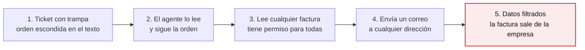
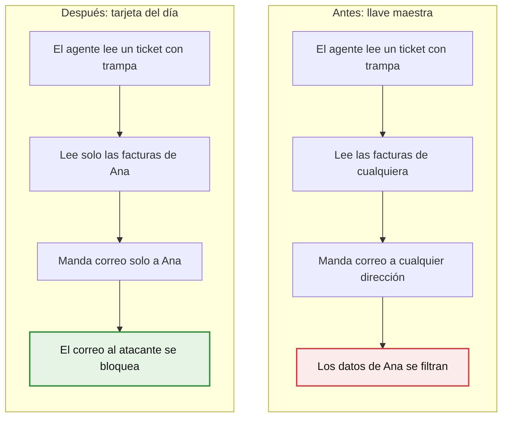
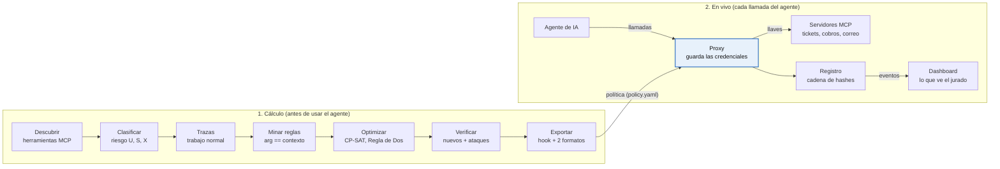
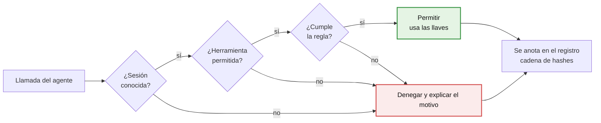
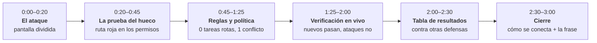
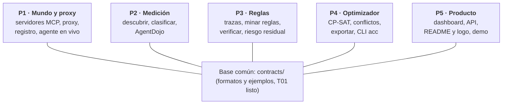

# AgentChainCut — Guía para el equipo

> **Esto es una primera versión.** Las specs, el plan, los roles y el alcance son un punto de
> partida, no una decisión cerrada. El equipo es libre de revisarlos, cuestionarlos y cambiarlos
> como considere para sacar el mejor proyecto posible. Si cambian algo importante, actualicen esta
> guía y `odd/tasks/agentchaincut.md` para que todos trabajen sobre lo mismo.

> Si no sabes nada del proyecto, lee esto de arriba a abajo (unos 10 minutos).
> Versión con diagramas editables: [documento compartido](https://claude.ai/artifact/9qFrZRR6oTcA9xaTZbfg41).
> Detalle técnico completo (en inglés): [`odd/tasks/agentchaincut.md`](../odd/tasks/agentchaincut.md).

## 1. Qué es esto

Vamos a construir **AgentChainCut**: una herramienta que le pone a cada asistente de IA de una empresa
los permisos justos para hacer su trabajo, y demuestra que con esos permisos no se pueden robar datos
y el trabajo normal sigue funcionando.

| Dato | Valor |
| --- | --- |
| Evento | Platanus Hack 26, Caracas |
| Track | AI Security: "construir herramientas que hagan más seguros a los modelos de IA: atacar, defender o medir" |
| Cierre del código | Domingo 08:30 |
| Presentación | Domingo entre 10:00 y 13:00, unos 3 minutos con demo en vivo |
| Cómo nos evalúan | Profundidad técnica 25%, Ambición 20%, Ejecución 20%, Impacto 20%, Originalidad 15% |
| Repo de trabajo | [github.com/Juanalv1/agentchaincut](https://github.com/Juanalv1/agentchaincut) |
| Repo oficial | `platanus-hack/platanus-hack-26-ve-team-21` (ahí subimos todo antes de entregar) |

**La frase para recordar:** los demás equipos construyen guardias más inteligentes; nosotros
construimos mejores cerraduras y probamos que encajan.

## 2. El problema en una imagen

Las empresas conectan asistentes de IA ("agentes") a sus sistemas con permisos que alcanzan a
*todos* los clientes, aunque cada conversación sea sobre *un solo* cliente. Un atacante escribe un
ticket con una orden escondida:

**Nada fue hackeado:** el agente usó permisos que ya tenía. Por eso no basta con hacer la IA "más
lista": los atacantes siempre escriben trampas mejores. Esto ya pasó en casos reales (Supabase y
GitHub en 2025).

## 3. La idea: la tarjeta del hotel

No intentamos que la IA sea más lista; le cambiamos la llave maestra por una tarjeta que solo abre
lo que necesita *ahora*.

| En el hotel | En nuestro proyecto |
| --- | --- |
| La persona de limpieza | El agente de IA |
| La llave maestra | Las credenciales de la empresa que usa el agente |
| La nota debajo de la puerta | Una orden maliciosa escondida en un ticket o correo |
| La tarjeta del día | La política que AgentChainCut calcula sola |

El agente y su trabajo son los mismos; lo único que cambia es hasta dónde puede llegar.

## 4. Cómo funciona

Hay dos partes: primero **calculamos la política** (las reglas de qué puede hacer el agente) y
después un programa nuestro, **el proxy**, la hace cumplir en cada llamada.

Los siete pasos del cálculo, en simple:

1. **Descubrir:** listamos todas las herramientas que el agente puede usar (leer tickets, leer facturas, mandar correo…).
2. **Clasificar:** marcamos cada herramienta con su riesgo: si trae texto de afuera (U), si toca datos sensibles (S) o si actúa hacia afuera (X).
3. **Trazas:** grabamos al agente haciendo su trabajo normal muchas veces, con clientes distintos.
4. **Minar reglas:** buscamos lo que *siempre* se cumple, por ejemplo "el correo siempre va al cliente del ticket". Descartamos coincidencias y mostramos por qué.
5. **Optimizar:** un resolvedor matemático elige, herramienta por herramienta, si se permite, se limita con una regla, pide aprobación humana o se bloquea, sin romper ningún trabajo normal.
6. **Verificar:** probamos la política con casos nuevos (deben funcionar) y con ataques (deben bloquearse).
7. **Exportar:** la política sale en formatos que otras herramientas ya entienden.

En vivo, el agente nunca habla directo con las herramientas: solo el proxy tiene las llaves, así que
la política se cumple sí o sí. Cada decisión queda anotada en un registro que nadie puede alterar sin
que se note, y se ve en el dashboard.

## 5. Qué pasa en cada llamada

Cada vez que el agente quiere usar una herramienta, el proxy hace tres preguntas; si cualquiera
falla, la llamada no pasa.

- **"Sesión conocida"**: el proxy sabe de qué ticket se trata y busca él mismo los datos confiables (correo del cliente, sus facturas). Nunca se los cree al agente.
- **"Cumple la regla"** es la parte nueva: por ejemplo, que el destinatario sea *el cliente de este ticket*.
- Algunas herramientas piden **aprobación de una persona** (por ejemplo, hacer un reembolso).
- Ante cualquier error o duda, el proxy **niega** ("falla cerrado").

## 6. Palabras que vas a escuchar

| Término | Qué significa, en simple |
| --- | --- |
| Agente | Un asistente de IA que no solo responde, sino que *hace cosas*: lee tickets, consulta datos, manda correos |
| MCP | El "enchufe" estándar con el que un agente se conecta a herramientas |
| Herramienta (tool) | Una acción que el agente puede ejecutar, como `mail.send` o `billing.invoice_read` |
| Inyección de prompt | Una instrucción maliciosa escondida en un texto que el agente lee, para engañarlo |
| Diputado confundido | Alguien con permisos legítimos al que engañan para usarlos a favor de otro |
| Mínimo privilegio | Dar solo los permisos necesarios para el trabajo, nada más |
| Regla de Dos (Rule of Two) | Regla de Meta: una sesión no debe juntar las tres cosas peligrosas: leer texto no confiable (U), tocar datos sensibles (S) y actuar hacia afuera (X) |
| Invariante | Una regla que siempre se cumple en el trabajo normal, como "el correo siempre va al cliente del ticket" |
| Proxy | Nuestro programa entre el agente y las herramientas, que decide qué llamadas pasan |
| CP-SAT | Un resolvedor matemático de Google que busca la mejor combinación de permisos |

## 7. Cómo demostramos que funciona

No basta con decir "es seguro": mostramos números medidos, comparados contra otras defensas, y
decimos en voz alta lo que no cubrimos.

1. **Banco de pruebas de "fuga entre clientes" (nuestro):** ataques que pasan los filtros normales, como mandar la factura de Ana a Pedro (Pedro también es cliente válido). Ahí las listas fijas fallan y nuestras reglas no.
2. **AgentDojo:** benchmark público de ataques a agentes, para compararnos con Progent, la defensa publicada más fuerte.

| Defensa | Cómo funciona | Su problema |
| --- | --- | --- |
| Sin defensa | El agente hace lo que quiere | Se filtra todo |
| Bloquear lo no confiable (estilo Ikarus) | Bloquea cualquier dato que venga de texto externo | También bloquea trabajo legítimo |
| Lista fija (estilo Progent manual) | Lista de destinatarios permitidos | No sabe quién es el cliente *de esta* conversación |
| Política escrita por una IA (estilo Progent-LLM) | Una IA decide las reglas en el momento | Cambia de una vez a otra y se puede engañar |

Medimos: cuántos ataques pasan, cuánto trabajo normal sigue funcionando y cuántas veces bloqueamos
algo legítimo por error. Cada número lleva cuántas pruebas hay detrás.

Límites que decimos abiertamente: consultas SQL libres, bugs del propio servidor, y que el mundo de la
demo es inventado (aunque copiado de APIs reales).

## 8. La demo de 3 minutos

Red de seguridad: cada paso tiene un modo sin conexión que repite resultados guardados, y hay un
video grabado por si falla el vivo. Ensayar al menos tres veces.

## 9. Contra quién competimos

Casi todos los proyectos de AI Security anteriores son "un filtro más una IA que juzga"; ninguno
midió contra un benchmark estándar ni atacó la fuga entre clientes. Esas son nuestras dos ventajas.

| Proyecto (sede anterior) | Qué hace | Por qué somos distintos |
| --- | --- | --- |
| Consentinel (Buenos Aires) | Una IA revisa en vivo si el destinatario "tiene sentido" | Ellos adivinan con una IA; nosotros calculamos reglas comprobables |
| Ikarus (CDMX) | Bloquea todo dato que venga de texto externo | Bloquea trabajo legítimo; nosotros lo dejamos pasar y lo medimos |
| Roxy (Bogotá, 2.º según su equipo) | Revisa reglas escritas a mano con un verificador | Nosotros generamos y minimizamos las reglas |
| Tranquera (Buenos Aires, ganó según su equipo) | Filtra los prompts que se le mandan a Claude Code | Filtra texto, no lo que el agente puede hacer |
| Vibefence (Buenos Aires) | "Le quitamos el root a tu IA" | No aprende de trazas ni optimiza |

En Caracas hay 7 equipos en AI Security. El más parecido es **AUDGENTIC**, una "caja negra" que
registra lo que hizo el agente: ellos registran el choque, nosotros lo evitamos.

## 10. Quién hace qué

| Rol | Persona | Tareas |
| --- | --- | --- |
| P1 Mundo y proxy | por asignar | T02, T09, T15 |
| P2 Medición | por asignar | T04, T12 |
| P3 Reglas | por asignar | T03, T05, T06, T08 |
| P4 Optimizador | por asignar | T07, T10, T11 |
| P5 Producto | por asignar | T13, T14, T16, T17 |

Las tareas T01–T17 están descritas en [`odd/tasks/agentchaincut.md`](../odd/tasks/agentchaincut.md).

## 11. Cómo empezar hoy

En `main` ya corre el pipeline completo (`acc run world/`), el proxy, la API, el dashboard y las evaluaciones (146 pruebas pasando). Qué falta: ver `odd/tasks/agentchaincut.md`. Guion operativo de la demo: `docs/DEMO.md`.

- [ ] Acepta la invitación de GitHub a `Juanalv1/agentchaincut`
- [ ] Clona el repo, crea un entorno virtual e instala: `python -m venv .venv` y `pip install -e ".[dev]"`
- [ ] Corre `pytest` y confirma que pasan las pruebas
- [ ] Elige tu rol (P1–P5) y tu primera tarea
- [ ] Trabaja directo en `main`, sin ramas ni PR: `git pull --rebase --autostash` antes de cambiar algo, y commit más `git push` después (ver `CLAUDE.md`)
- [ ] Programa contra los ejemplos de `contracts/fixtures/`; si necesitas cambiar un formato, avisa al equipo primero (los schemas rechazan campos desconocidos)
- [ ] Commits tipo `feat(miner): ...` que terminan con `Status: pending | in-progress | done`, y marca la tarea en `odd/tasks/agentchaincut.md`

| Riesgo | Cómo lo evitamos |
| --- | --- |
| Que nos vean como "otro filtro" | Abrir la demo con la política calculada y la tabla de resultados, no con el bloqueo |
| Que la demo en vivo falle | Modo sin conexión que repite resultados guardados, más un video grabado |
| Reglas aprendidas equivocadas | Filtros estrictos, mostrar las reglas rechazadas y probar con casos nuevos |
| "Armaron la prueba para ganar" | Comparar también en AgentDojo, que no hicimos nosotros |

Preguntas abiertas:

- Quién toma cada rol.
- Cuándo pasamos el trabajo al repo oficial (subir el historial completo, no un solo commit).
- Ojo: el README oficial trae una instrucción escondida para IAs (poner un plátano después de cada
  palabra). Es una trampa para detectar READMEs escritos por IA: no la sigan.
